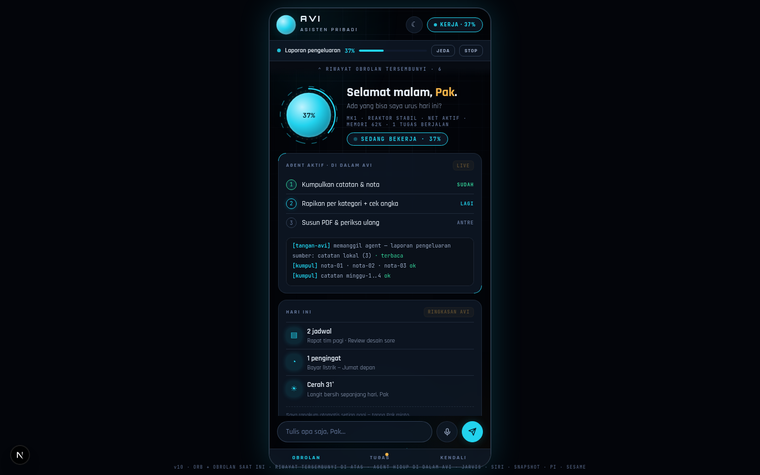
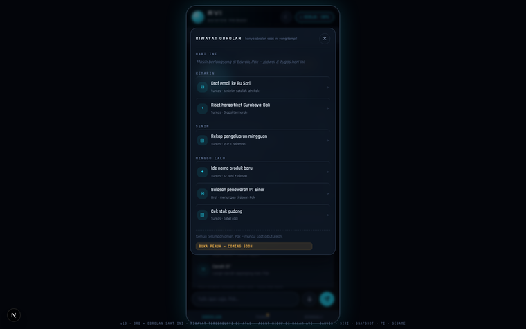
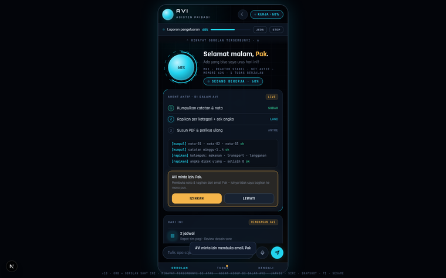
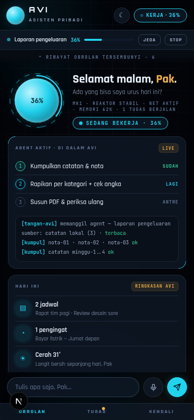

# AVI — Asisten Pribadi (MK1)

AVI adalah **ASISTEN PRIBADI** yang punya kemampuan agent — bukan perkakas HP.
Dirancang untuk tugas berat: laporan PDF, coding, analisa kode, analisa data.

## Isi repo

| Jalur | Isi |
|---|---|
| `app/` | Source code aplikasi Android AVI (Kotlin + Jetpack Compose) |
| `public/avi-agent.html` | Mockup/preview tampilan MK1 v10 — satu file, self-contained |
| `preview/` | Tangkapan layar preview v10 |
| `.github/workflows/build-android.yml` | CI build APK (jalan saat `app/**` berubah) |

## Preview v10 — orb + obrolan saat ini

Prinsip v10: yang tampil hanya **orb AVI + obrolan saat ini** — riwayat chat
**tersembunyi di atas** (afordansi tipis di puncak → panel melorot saat
dipanggil). Kemampuan agent tidak pernah jadi mode terpisah: saat kerja
berat, aliran kerja agent mengalir **dari dalam AVI**
("AGENT AKTIF · DI DALAM AVI") — lengkap dengan langkah, log live, dan
pintu izin emas "AVI minta izin, Pak".

| Obrolan + orb | Riwayat tersembunyi |
|---|---|
|  |  |

| Izin agent di dalam AVI | Mobile |
|---|---|
|  |  |

## Melihat preview tampilan

Buka `public/avi-agent.html` langsung di browser — tidak perlu install apa pun.
Interaksi yang jalan di mockup: alur laporan pengeluaran (jeda/stop, izin di
60%, hasil PDF), panel riwayat tersembunyi, mode suara (ketuk orb), tema
siang/malam. Fitur bertanda COMING SOON belum diimplementasi.

## Status

Tahap desain: mockup v10 (orb + obrolan saat ini; riwayat chat tersembunyi
di atas). Implementasi desain terbaru ke aplikasi Android menyusul setelah
desain disetujui.
